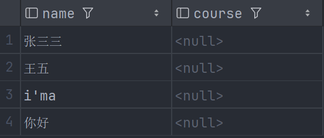
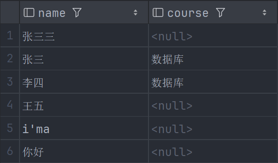
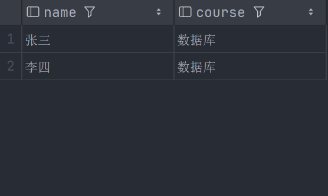
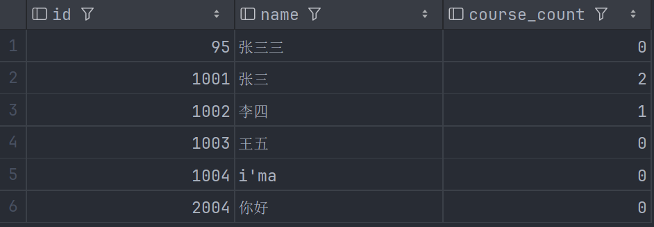
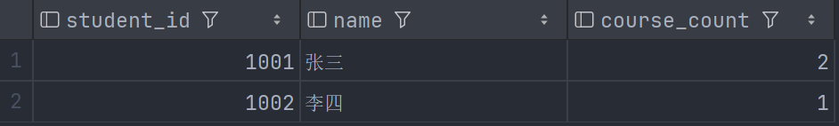

## 记录

happy-learning :D

### 左连接 1

前情提要：现在有这么两张表

```sql
CREATE TABLE Student
(
    id   INT PRIMARY KEY, -- 主键，唯一标识符
    name VARCHAR(20),
    age  INT
);

INSERT INTO Student (id, name, age)
VALUES (1001, '张三', 20),
       (1002, '李四', 19),
       (1003, '王五', 21),
       (1004, 'i''ma', 101),
       (0095, '张三三', 20),
       (2004, '你好', NULL);
```

和

```sql
CREATE TABLE Enrollment
(
    student_id INT,
    course VARCHAR(30)
);

INSERT INTO Enrollment (student_id, course)
VALUES
    (1001, '数据库'),
    (1001, '编译原理'),
    (1002, '数据库');
```

那么请问，一下两种写法有什么不同之处？

```sql
-- 写法 1
SELECT student.name, Enrollment.course
FROM student
LEFT JOIN Enrollment
    ON student.id = Enrollment.student_id
WHERE Enrollment.student_id IS NULL -- look here
ORDER BY student.id, Enrollment.course;

-- 写法 2
SELECT student.name, Enrollment.course
FROM student
LEFT JOIN Enrollment
    ON student.id = Enrollment.student_id
WHERE course IS NULL -- look here
ORDER BY student.id, Enrollment.course;
```

对于上面的两个表，这两种写法的输出没有任何区别，都是：



但如果选课表中存在这样一行：

```txt
(1003, NULL)
```

表示 1003 号同学存在一条选课记录，但出于某种原因课程名尚未填写，此时写法 1 不会选中 1003 同学，而写法 2 会。

### 左连接 2

以下两种写法：

```sql
-- 找不同
-- 写法 1
SELECT student.name, Enrollment.course
FROM student
LEFT JOIN Enrollment
    ON student.id = Enrollment.student_id
    AND Enrollment.course = '数据库'
ORDER BY student.id;
-- 写法 2
SELECT student.name, Enrollment.course
FROM student
LEFT JOIN Enrollment
    ON student.id = Enrollment.student_id
WHERE Enrollment.course = '数据库'
ORDER BY student.id;
```

写法 1 输出：



写法 2 输出：



可见，ON 决定怎样匹配，WHERE 决定连接后的那些行留下。

### 子查询 1

内层可以访问外层，外层不能访问内层。这个应该属于作用域。

对于下面这两种写法：

```sql
-- 统计每名学生选了几门课
-- 写法 1
SELECT Student.id, Student.name,
       (
            SELECT COUNT(*)
            FROM Enrollment
            WHERE Enrollment.student_id = STudent.id
       ) AS course_count
FROM Student;

-- 写法 2
SELECT student_id,
       (
            SELECT name
            FROM Student
            WHERE Enrollment.student_id = STudent.id
       ) AS name,
       COUNT(*) AS course_count
FROM Enrollment
GROUP BY Enrollment.student_id;
```

写法 1 输出：



写法 2 输出：



因为外层的 `FROM` 决定从哪些记录出发。内层子查询只能为外层已有的行计算值，不会帮它增加学生。
